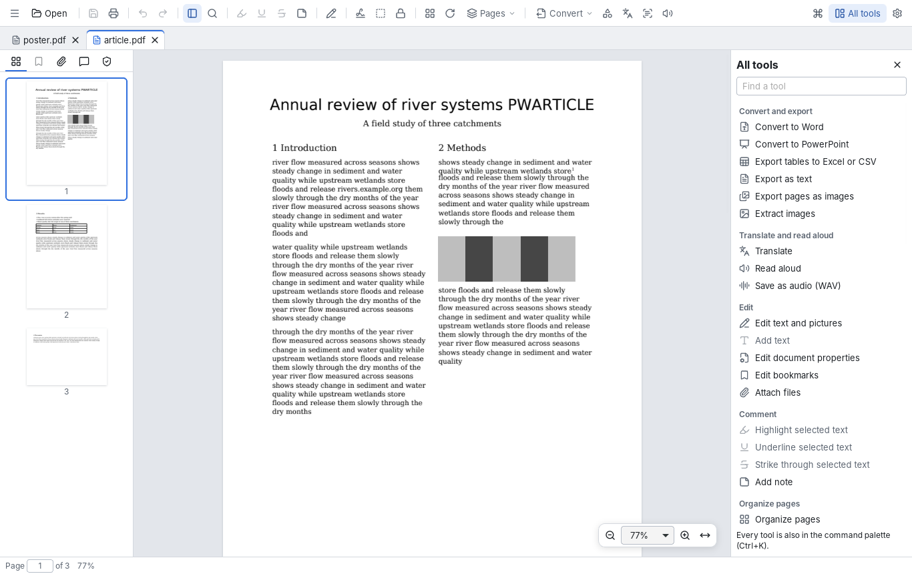
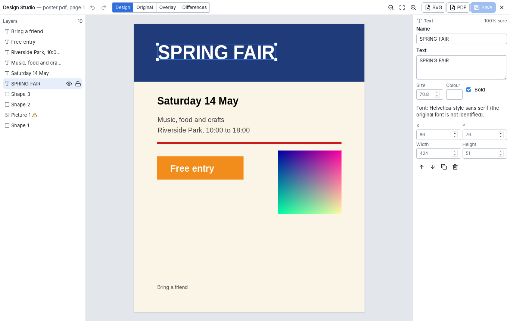
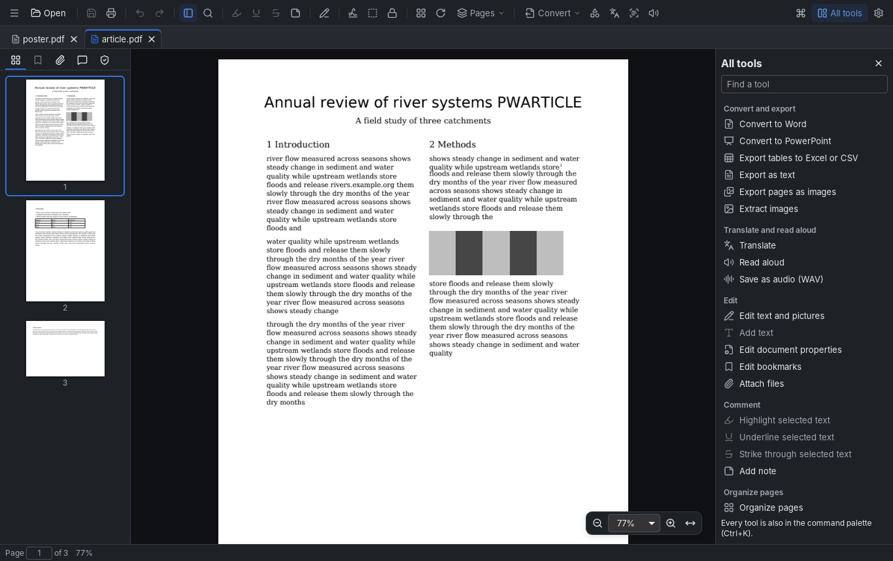

<div align="center">


# PageWeave

**A free, open-source document studio for Windows that works on your computer — no account, no cloud, no AI subscription.**

[](https://github.com/Openera-ltd/pageweave/actions/workflows/ci.yml)
[](LICENSE)
[](#install-and-build)
[](#status)

[](#privacy)
[](#how-it-is-built)
[](#how-it-is-built)
[](#how-it-is-built)
[](#use-with-an-ai-agent-mcp)
[](THIRD_PARTY_NOTICES.md)

[Features](#what-you-can-do) · [Status](#status) · [Install and build](#install-and-build) · [Command line](#command-line) · [AI agents](#use-with-an-ai-agent-mcp) · [Privacy](#privacy) · [License](#license)

</div>

---

## What is PageWeave?

PageWeave opens, edits, converts and checks PDF files on your own computer. Everything runs locally:
your documents never leave the machine, and every feature works without an internet connection or an
outside AI service. Your original files are never changed — every edit is saved as a **new** file that
PageWeave checks before it is kept.

<p align="center">
  
</p>

<details>
<summary><b>More screenshots</b></summary>

<br>

<p align="center">
  
  <br><em>Design Studio: a flat flyer rebuilt as editable text, shapes and pictures.</em>
  <br><br>
  
  <br><em>Dark theme.</em>
</p>

</details>

## What you can do

| | |
|---|---|
| **View and find** | Tabs, smooth scrolling, thumbnails, bookmarks, zoom, find with highlights, select and copy text |
| **Organize pages** | Reorder, rotate, delete, extract, insert, split, combine, crop, page numbers, stamps and watermarks |
| **Edit** | Change text in place, move and replace pictures, add text, highlight, underline, sticky notes |
| **Forms** | Fill in forms on the page, clear or reset them, export and import the answers |
| **Convert** | PDF → Word, PowerPoint, Excel/CSV tables, text and images; images → PDF; open Word, Excel and PowerPoint files (with LibreOffice installed) |
| **Translate** | Translate pages between English, German, French, Spanish, Italian and Portuguese into a Word file that keeps the layout |
| **Design Studio** | Rebuild a flat poster, flyer or screenshot (picture or PDF page) as editable text, shapes and pictures; edit, compare with the original, export SVG or PDF |
| **Read aloud** | Hear the document with your computer's voices, the spoken word highlighted; save it as audio |
| **Scans** | Make scans searchable (OCR), straighten them, turn them upright, remove blank pages |
| **Protect and clean** | Passwords, permanent redaction, remove hidden information, find sensitive text |
| **Sign and check** | Sign with a certificate, verify signatures, compare two versions, check accessibility |
| **Automate** | Process many files at once, script everything with the `pageweave` command line, or let an AI agent use it through MCP |

<details>
<summary><b>Every feature in detail, with how it is tested</b></summary>

<br>

| Area | What works | Evidence |
|---|---|---|
| PDF engine | Open (with password), inspect metadata/pages/bookmarks, extract text, search with match geometry, render pages | `crates/pw-pdf/tests/engine.rs` (Linux and Windows CI) |
| Page operations | Organize (reorder, duplicate, rotate, remove, insert pages from another file in one step), page numbers / headers / footers / Bates-style numbering, page labels (i–iv then 1, 2, … with prefixes), export pages as PNG images, extract, delete, rotate, split (every N pages, by ranges, by bookmarks with parts named after them, or by largest file size), combine — always to a **new** file; source never modified; outputs re-opened and verified before an atomic commit; explicit conflict policy | engine tests (outputs re-parsed with an independent parser) |
| CLI | `pageweave` with JSON output and stable exit codes | `crates/pw-cli/tests/cli.rs`; packaged Windows smoke test in CI |
| Desktop app | Tabs, continuous viewer, thumbnails, bookmarks, zoom/fit, find with highlights, text selection and copy, page tools, settings (theme/accent/density/text size/motion/shortcuts), command palette, context menus, drag-and-drop and command-line open | `app/e2e/run.mjs` drives the real app (66 scenarios incl. axe-core accessibility checks) on Linux and Windows CI; Windows installer install/launch/uninstall smoke in CI |
| Forms | Fill AcroForm text, multiline, checkbox, radio, combo and list fields directly on the page; values are entered through PDFium's form filler so the saved copy's appearances show them; Ctrl+S saves all changes (fields and annotations) into one verified copy, then the tab switches to it | engine tests verify values, button states and regenerated appearance streams with an independent parser and by rendering; E2E fills every kind in the real app and checks the saved file with the CLI |
| Batch processing | Process several files: reduce size, recognize text, remove hidden information, straighten, turn upright, export text, convert to Word or to PowerPoint for many PDFs at once into a folder; per-file results, stop the rest; originals never changed | unit tests; E2E runs, repeats (existing results kept) and stops a batch in the real app |
| Form data | Export the form's values (including unsaved changes) as XFDF — readable by most PDF apps — or JSON; import an XFDF or JSON file with a preview of which fields it fills and why any value is not used (unknown name, read-only field, no such option), then the values become unsaved changes (Undo available) to save as a copy. CLI: `pageweave form-export`, `pageweave form-import` (`--preview` or `-o`). Data files are treated as untrusted: size, count and nesting limits; XML document type declarations and custom entities are refused | format tests (round trips, nested names, special and control characters, hostile files); engine tests fill copies and check values with an independent parser, including that the data file can never be overwritten; E2E exports, previews, imports, undoes and saves in the real app, then checks the copy with the CLI |
| Convert to Word | PDF → editable Word (.docx): paragraphs re-flowed from the PDF's lines, headings (as Word heading styles), columns, centred/right/justified alignment, indents and spacing, bold/italic/colour/size, superscripts, web and mail links, pictures (JPEG kept exactly as stored; masked pictures keep their transparency), ruled tables as Word tables (merged cells included), other aligned rows on tab stops, each page's own size and orientation; a report lists what was not carried over | every character of the PDF is checked in the Word file before it is written, and again by an independent reader in the tests; LibreOffice opens and re-lays-out every test file with the same page count, 100% word agreement and measured ink overlap (`docs/benchmarks/DOCX_BASELINE.md`); E2E in the real app |
| Convert to PowerPoint | PDF → PowerPoint (.pptx): one slide per page at the page's size, paragraphs as editable text boxes in place (fonts, sizes, bold/italic, colours, links), ruled tables as PowerPoint tables, pictures in place; pages of another size are scaled to the first page's (reported) | every character checked in the slides before the file is written; LibreOffice lays the slides out again with the same characters and ink coverage ≥ 0.947 (`crates/pw-pdf/tests/pptx.rs`); E2E in the real app |
| Translate | PDF pages → translated Word document (same headings, columns, tables and pictures) or text, on this computer with OPUS-MT models (included in the full installer; a missing language downloads its shared model once, about 290–320 MB, resumed if interrupted and checked against its pinned checksum; kept across app updates): every pair of English, German, French, Spanish, Italian and Portuguese, each translated directly (30 directions from three shared models, D-027); language detected or chosen; names, codes, numbers and addresses kept, and any not kept are listed (also CLI `translate`, MCP `translate_document`) | FLORES-200 scores in `docs/benchmarks/TRANSLATION_BASELINE.md`; engine tests check values kept and routes; E2E in the real app |
| Read aloud | Read the document aloud with the computer's own voices (Windows speech voices; nothing bundled): from the current page (toolbar, Ctrl+Shift+L, palette), from a text selection or from a page's menu; columns are read one after another and tables cell by cell; the word being heard is highlighted and kept in view (scrolling by hand stops following until "Follow"); pause/resume, previous/next sentence, speed 0.75–2× and voice (both remembered); save pages as a WAV file (also CLI `speak`, MCP `read_aloud_to_wav`) | highlighting follows the audio's own clock and the engine's word timings (Windows) or sentence timings (Linux development builds use `flite`), never a timer; unit tests of the reader logic and bar, engine tests (reading order, word positions equal search results, WAV verified), E2E in the real app with a virtual sound device |
| Open Office files | Word, Excel, PowerPoint, OpenDocument, RTF, text, CSV and HTML files are converted to PDF and opened (start screen, palette, dropping the file, or passing it to the app); uses LibreOffice when it is installed on the computer (not bundled), in a private profile with macros switched off, on a copy of the file, with a time limit | text of Word/Excel/PowerPoint/text files checked in the PDF; a document with an auto-run macro does not run it; missing LibreOffice, damaged files, time limit and cancellation tested; E2E in the real app |
| Export tables | Ruled tables (drawn grids) to an Excel workbook (one sheet per table, merged cells kept) or CSV files; values kept exactly — only plain exact numbers become numbers, while codes with leading zeros, long identifiers, dates, grouped amounts and trailing zeros stay text; CSV cells that a spreadsheet would run as formulas are defused | every workbook and CSV file is read back cell by cell before it is written; LibreOffice reads the workbook back with every value unchanged; E2E in the real app |
| OCR | Recognise text on scanned pages and save a searchable copy (invisible text layer over the words; pages look identical); pages that already have text are left alone | Benchmark against Tesseract on a synthetic, rights-clean corpus (`docs/benchmarks/OCR_BASELINE.md`); engine tests check word recall, placement and search; E2E runs it in the real app; the Windows package runs it in CI |
| Password protection | Encrypted copy (AES-256) with an open password and optional permissions; protected originals can be re-protected with a new password | engine tests check refusal without the password, content, and the encryption dictionary with an independent parser; E2E protects and reopens in the real app |
| Images to PDF | JPEG and PNG files to a PDF, one per page (A4, Letter or image size); JPEGs embedded unchanged, phone photos turned upright; drop images on the window to start | JPEG bytes compared inside the PDF; orientation and transparency checked in renders |
| Edit bookmarks | Add from a page's menu, rename, re-point, nest, reorder and delete bookmarks; saved into a new file | the saved outline is read back by PDFium and compared item by item; E2E in the real app |
| Attachments | See embedded files in the sidebar, save one out exactly as stored (never opened), attach files into a new copy | contents compared byte-for-byte after saving and attaching; E2E in the real app |
| Crop pages | Trim margins (mm, in or pt) as displayed on all or chosen pages; content outside is hidden, not removed (said each time) | crop boxes read back by an independent parser, rotated pages included; E2E in the real app |
| Watermark | Text watermark with size, colour, opacity and angle, over or behind the content, on chosen pages | text found on exactly the chosen pages, translucency and angle measured in renders; pages where it cannot be seen are reported; E2E in the real app |
| Document properties | View, and edit title, author, subject and keywords into a new file (XMP kept in step) | values read back by PDFium and an independent parser; every page renders as before; E2E edits and re-inspects in the real app |
| Remove password | Copy that opens without a password; files whose owner restricted them need the permissions password | engine tests check the copy opens without a password with identical text and no encryption dictionary (independent parser), and that restrictions are honoured; E2E in the real app |
| Remove hidden information | Lists and removes metadata, scripts and actions, attachments, hidden layers and comments (optionally form fields and web links) in a new file; earlier saved versions always removed | every removed kind is searched for in the whole output with an independent parser, and each page must render exactly as before; E2E cleans and re-inspects in the real app |
| Redaction | Mark text (selection or every search match), dragged areas or whole pages; review what each area removes; apply to a **new** file. Content under the areas is removed (text per character, image pixels, drawings, comments/links, form widgets), the areas painted black, and the copy rewritten without unused resources, thumbnails, metadata or revision history; it is verified before it is written (no text, annotation or image data left under any area; rendering unchanged elsewhere; removed image data absent from the file) | engine tests search every object and stream of the output with an independent parser, including negative tests that prove the checks reject leaky output; CLI `redact`; E2E marks, reviews and applies in the real app, then checks the copy with the CLI and its raw bytes |
| Edit text and pictures | Change the wording of a text line in place, move lines and pictures, turn, replace or delete pictures, add new text; the engine renders an exact preview; undo/redo; saved into a **new** copy together with annotations and form fields (CLI: `pageweave objects`, `pageweave edit`) | engine tests reopen every saved copy and check its text, fonts and pictures; E2E edits in the real app and checks the copy with the CLI |
| Annotations | Highlight, underline, strikethrough and sticky notes from a text selection or a right-click; undo/redo; saved into a **new** PDF (verified by reopening); closing a tab or the window with unsaved annotations asks first | engine tests (independent parser + rendered pixels); E2E checks the saved file and the real window-close request |

</details>

## Status

> [!WARNING]
> **Early development — not production ready yet.** The features above are built and tested
> automatically on Linux and Windows, but a release still needs measured performance on real Windows
> PCs, screen-reader checks with Narrator and NVDA, code signing, and checks in Microsoft Office.
> The full list lives in [`docs/RELEASE_CHECKLIST.md`](docs/RELEASE_CHECKLIST.md); every feature's
> evidence and limits are in [`docs/FEATURE_PARITY_MATRIX.md`](docs/FEATURE_PARITY_MATRIX.md).

<details>
<summary><b>Known limitations</b></summary>

<br>

- Combining PDFs does not carry over bookmarks or document metadata (the app says so).
- Outputs made by extract/delete/split/combine from a password-protected PDF are **not** protected (the app warns); rotate keeps the protection.
- Editing text: each line is edited on its own (no paragraph reflow); letters missing from an embedded subset font switch the line to a standard font (the app warns); text in scripts the font cannot draw is refused; turned or slanted text cannot be edited yet; pictures have no resize handles.
- Annotations: fixed colours for new ones; existing comments and markup can be deleted or have their comment text changed (Comments panel), not moved, resized or recoloured yet; text boxes' own text can't be edited; a deleted annotation stays visible on the page until the saved copy is opened; changes are never saved back into the original file by design.
- Forms: no form authoring, field validation scripts, calculation order, signatures or XFA filling (XFA is detected and reported). Native input undo only for field edits; Clear form empties text fields and checkboxes but cannot empty choice lists or radio groups; Reset form restores the document's default values (choice lists and radio groups without a default keep their value). Form data: FDF files are not read yet (refused with a message); a list box takes one value per import; rich-text values and clearing a radio choice are reported as not used.
- Redaction: bookmarks, document properties, attachments and fillable fields are not carried over to the redacted copy; a page whose content cannot be removed precisely (grouped content or unreadable text crossing an area) becomes an image of the page (the app says which); drawings only partly under an area (e.g. backgrounds) are covered but kept; pattern search finds e-mail addresses, phone numbers, card numbers (Luhn-checked), IBANs (checksum-checked), US SSNs and custom regular expressions in the text layer only — scanned text must be recognized first, and every match should be reviewed (look-alikes and unusual formats are possible).
- OCR: accuracy measured on synthetic English/Latin pages only; the text layer carries Latin characters; no handwriting, layout or table structure; Windows speed not yet measured.
- Office formats: PDF → Word, PowerPoint and (tables) Excel/CSV. Opening Office files needs LibreOffice installed separately (not bundled; Settings ▸ Resources shows it as optional) and is not tested on Windows CI (no LibreOffice there). In Word/PowerPoint, tables without drawn lines stay rows of text on tab stops; other drawn lines/shapes, comments and fillable fields are not carried over, and turned text is placed after its page (all reported per file). Measured on synthetic fixtures with LibreOffice as the reader; not yet checked in Microsoft Word. Tables export to Excel/CSV from drawn grids and from columns of text aligned over three or more rows (a wrapped cell becomes its own row); no PowerPoint export, and no opening of Office files yet.
- Read aloud: voices and languages are whatever the computer has installed (Windows Settings ▸ Speech); a voice reads every language with its own pronunciation (no automatic language switching yet); no pronunciation dictionary, audio formats other than WAV, or voice cloning; resuming where you stopped after closing the document is not kept. The Windows path's word timings are checked on Windows CI only.
- Translation: machine translation (review it); six languages only; mixed formatting inside a paragraph becomes one style; no glossary, bilingual output or batch translation yet; scanned pages need text recognition first.
- XFA forms are detected but cannot be displayed or filled.
- Design Studio: flat pictures have no layers, so objects are the Studio's best guess: text lines (one object per line, Helvetica-style font), single-colour rectangles, and everything else kept as pictures marked for checking; text over a picture also stays in the picture; no rotation, grouping, snapping or picture replacement yet; measured on a synthetic poster only.
- No measured performance budgets or hardware support claims yet (`docs/HARDWARE_SUPPORT.md`).
- Screen-reader behaviour has not yet been verified with Narrator/NVDA.
- Crash containment: jobs run in worker processes and the viewer's pages and reads in reader processes, so an engine crash on a damaged file fails that job or that page ("could not be displayed"), not the app. Measured on Linux; the crash test runs on debug builds only.
- Accessibility check: automated structure checks plus a list of what to review by hand; it does not edit or add tags and is not a PDF/UA or WCAG conformance verdict.

</details>

## Install and build

**Download:** get `PageWeave_<version>_x64-setup.exe` (about 1 GB, every translation language
included) from the [latest release](https://github.com/Openera-ltd/pageweave/releases/latest) and run it
(installs for the current user, no administrator rights). The installer is not yet code-signed with a Windows certificate,
so Windows SmartScreen may ask you to confirm ("More info" → "Run anyway").

**Updates:** PageWeave checks for a new version when it starts (Settings ▸ Updates; can be switched off).
An update downloads only the program (`…_x64-update-setup.exe`, about 40 MB), checks its signature
against the key built into the app, and installs over the old version. Downloaded languages, settings and trusted certificates are kept, so
nothing else is downloaded again.

**Build it yourself:**

**You need:** Rust (stable), Node.js 22 and Python 3. On Linux also `libwebkit2gtk-4.1-dev` and `librsvg2-dev`.

```sh
# 1. Download and verify the pinned engines and models (checksums are checked)
python3 -I tools/fetch_pdfium.py
python3 -I tools/fetch_ocr.py
python3 -I tools/fetch_translate.py

# 2. Build the interface and run the tests
cd app && npm ci && npx vite build && cd ..
cargo test --workspace            # engine, CLI and app tests
(cd app && npx vitest run)        # interface tests

# 3. Build the app
cd app && npx tauri build         # Windows installers (NSIS + MSI)
```

<details>
<summary><b>Run the real-app tests</b></summary>

<br>

```sh
cd app && npx tauri build --debug --no-bundle
./e2e/run.sh ../target/debug/pageweave-app ../e2e-artifacts
```

On Linux this needs `xvfb`, `webkit2gtk-driver` and `tauri-driver`; read aloud also needs `flite` and a
sound device (CI uses a PulseAudio null sink).

</details>

## Command line

Everything the app does is also available as `pageweave`, with JSON output (`--json`) and stable exit codes.

```sh
pageweave inspect report.pdf
pageweave extract --pages "1-3, 5" -o excerpt.pdf report.pdf
pageweave to-docx -o report.docx report.pdf
pageweave translate --to de -o report-de.docx report.pdf
pageweave ocr -o searchable.pdf scan.pdf
pageweave design -o flyer.pwdesign flyer.png && pageweave design-export flyer.pwdesign -o flyer.svg
```

<details>
<summary><b>More examples</b></summary>

<br>

```sh
pageweave inspect report.pdf
pageweave extract --pages "1-3, 5" -o excerpt.pdf report.pdf
pageweave --json --on-conflict rename merge a.pdf b.pdf -o combined.pdf
pageweave --password-stdin inspect protected.pdf < password.txt
pageweave --password-stdin unprotect -o open.pdf protected.pdf < password.txt
pageweave properties --title "Q3 report" --author "" -o report-q3.pdf report.pdf
pageweave text --pages 2-4 -o report.txt report.pdf     # without -o the text is printed
pageweave images-to-pdf scan1.jpg scan2.jpg --page-size a4 -o scans.pdf
pageweave attachments report.pdf                       # list; --save 0 -o file / --add a.csv -o copy.pdf
pageweave crop --top 10 --bottom 10 --unit mm -o report-trimmed.pdf report.pdf
pageweave watermark --text DRAFT --opacity 20 --angle 45 -o report-draft.pdf report.pdf
pageweave optimize -o report-smaller.pdf report.pdf    # lossless; images unchanged
pageweave optimize --image-dpi 150 --image-quality 75 -o photos-small.pdf photos.pdf   # also resample images
pageweave extract-images -o images/ report.pdf          # embedded images: JPEG as stored, others PNG
pageweave blank-pages scan.pdf                           # list blank pages; remove with delete --pages
pageweave orient -o scan-upright.pdf scan.pdf           # turn sideways/upside-down scans upright
pageweave deskew -o scan-straight.pdf scan.pdf           # straighten skewed scanned pages (lossless)
pageweave signature-mark --box 350,40,560,100 --text "Ada Lovelace" -o signed.pdf form.pdf   # picture of a signature
pageweave sign --certificate me.pfx -o contract-signed.pdf contract.pdf   # password on stdin
pageweave signatures contract.pdf                       # integrity of each signature (trust not checked yet)
pageweave compare report-v1.pdf report-v2.pdf          # page, text, format and visual differences
pageweave split --by-bookmarks 1 --out-dir chapters/ book.pdf   # or --max-size 10MB
pageweave form-export -o answers.xfdf form.pdf             # or answers.json / --format json
pageweave form-import --preview form.pdf answers.xfdf   # which fields it fills; -o filled.pdf to fill
pageweave annotations report.pdf                       # list comments; --delete 1:0:Text / --set-text 1:2:Highlight=OK -o copy.pdf
pageweave labels --range 1:roman-lower --range 5:decimal -o book-labelled.pdf book.pdf
pageweave resources                                    # installed engine and OCR files verified against pinned checksums
pageweave accessibility report.pdf                     # automated checks + what to review by hand
pageweave patterns --kinds email,phone,card,iban,ssn report.pdf   # sensitive text with positions
pageweave sanitize --inspect report.pdf
pageweave sanitize --remove-web-links -o report-clean.pdf report.pdf
```

</details>

## Use with an AI agent (MCP)

`pageweave mcp` lets an AI agent that supports the Model Context Protocol (for example Claude Desktop or
Claude Code) use PageWeave's own document tools. It runs over standard input/output — nothing listens on
the network — and only touches files inside the folders you name:

```json
{
  "mcpServers": {
    "pageweave": {
      "command": "C:\\Program Files\\PageWeave\\pageweave.exe",
      "args": ["mcp", "--root", "C:\\Users\\you\\Documents\\PDFs", "--allow-write"]
    }
  }
}
```

- Read tools: `list_capabilities`, `inspect_document`, `extract_text`, `search_text`, `list_form_fields`,
  `compare_documents`, `check_signatures`, `check_accessibility`, `find_sensitive_text`.
- With `--allow-write` also: `extract_pages`, `delete_pages`, `rotate_pages`, `merge_documents`,
  `split_document`, `fill_form`, `recognize_text` (OCR, with progress and cancel), `reduce_file_size`,
  `export_text`, `convert_to_docx`, `convert_to_pptx`, `export_tables` (Excel), `read_aloud_to_wav`, `translate_document`, `reconstruct_design`, `export_design`. These only create **new** files; existing files are never replaced or changed.
- Not available through MCP: password-protected files, signing, redaction, removing hidden information,
  passwords and attachments. Paths outside the named folders (including through symbolic links) are refused.
- The agent and its AI model are separate from PageWeave; nothing here sends documents anywhere. What the
  agent does with text it reads from your documents is up to the agent.

## Privacy

- **Nothing is uploaded.** PageWeave's own code makes no network requests while you work with documents
  (not yet confirmed with network monitoring on Windows, where the WebView2 runtime is a separate
  Microsoft component). It goes online only to:
  - download a translation language when you first use it (from this project's GitHub release,
    checked against pinned SHA-256 hashes);
  - check this project's GitHub release page for a new version at startup (Settings ▸ Updates can
    switch this off), and download the update when you choose to.

  Nothing about you or your documents is sent in either case.
- **Logs stay private.** They record operation names, timings, page counts and error codes — never
  document text, file names (paths are replaced by a short hash) or passwords. Open them with the command
  palette (Ctrl+K) → "Show log folder".
- **Passwords** are held in memory only while a document is open.

## How it is built

| Part | What it does |
|---|---|
| [`crates/pw-core`](crates/pw-core) | Shared foundation: operation types, errors, page ranges, safe file writing, jobs, settings, logging |
| [`crates/pw-pdf`](crates/pw-pdf) | The document engine, built on PDFium (JavaScript and XFA disabled), pinned by checksum |
| [`crates/pw-ocr`](crates/pw-ocr) | Text recognition (PP-OCRv6 models on ONNX Runtime) |
| [`crates/pw-translate`](crates/pw-translate) | Translation (OPUS-MT models on the same runtime) |
| [`crates/pw-speech`](crates/pw-speech) | Read aloud with the computer's voices |
| [`crates/pw-cli`](crates/pw-cli), [`crates/pw-mcp`](crates/pw-mcp) | The `pageweave` command line and the MCP server for AI agents |
| [`app/`](app) | The Tauri 2 desktop app: Rust host and React/TypeScript interface |

The app, the command line and the MCP server all run the same operations through one engine
(`pw_pdf::execute`). Design decisions are recorded in [`docs/DECISIONS.md`](docs/DECISIONS.md).

## License

PageWeave is released under the [MIT License](LICENSE). Bundled third-party components and models, and
their licenses, are listed in [`THIRD_PARTY_NOTICES.md`](THIRD_PARTY_NOTICES.md) and
[`third_party/licenses/`](third_party/licenses).
